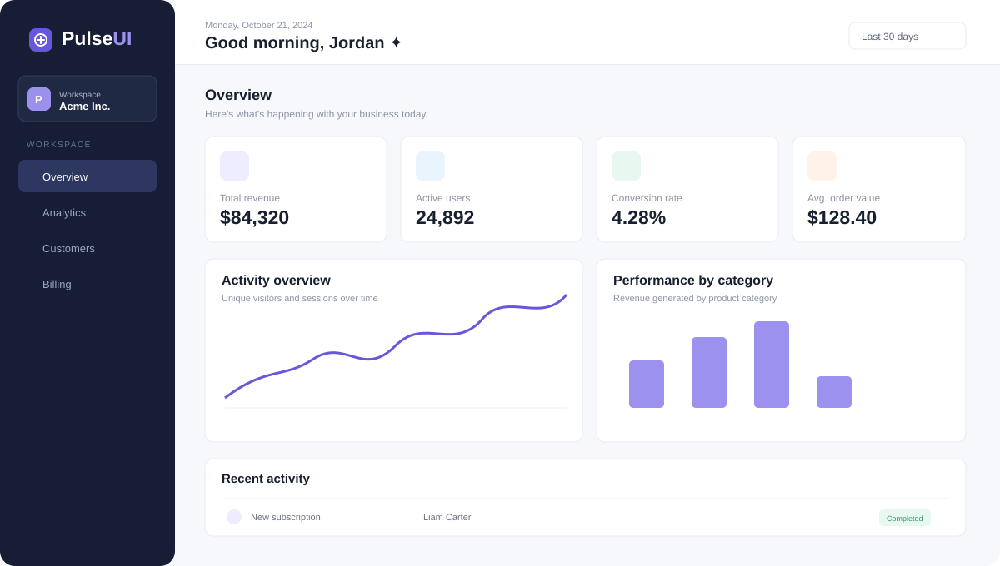

# PulseUI

PulseUI is a responsive SaaS analytics dashboard built with React, Vite, Recharts and lucide-react. It runs entirely from a local dataset, so no backend is required.



## Features

- Dark workspace sidebar with responsive mobile drawer
- KPI summary cards and responsive activity/category charts
- Recent activity table with search, status filtering, sortable date/amount columns and pagination
- Empty results, loading, error and retry states
- Keyboard-friendly labelled controls and stable data keys

## Architecture

- `src/App.jsx` composes the page and reusable dashboard/table components.
- `src/data/dashboardData.js` contains the chart, KPI and activity data used by the dashboard.
- `src/utils/tableUtils.js` contains the pure search/filter/sort pipeline.
- `src/App.css` and `src/index.css` contain the visual system and responsive layout.

## Commands

```bash
npm install
npm run dev
npm test
npm run lint
npm run build
```
